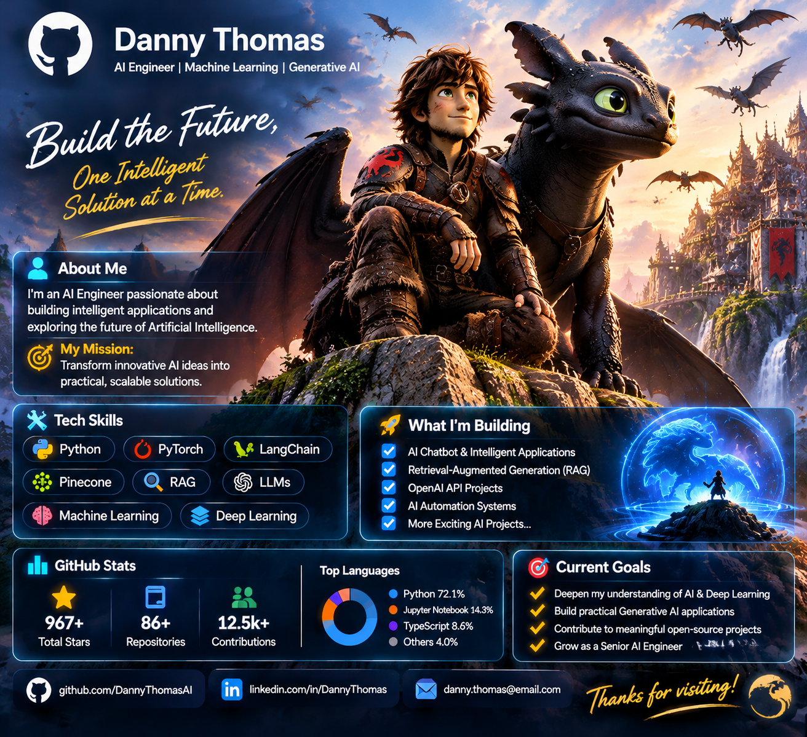

 

# 🐉 Hello, I'm an AI Engineer

### Building Intelligent Solutions with Artificial Intelligence

*Turning ideas into intelligent technology.*

  

## 👨‍💻 About Me

I'm passionate about Artificial Intelligence, Machine Learning, and building intelligent applications that solve real-world problems.

- 🤖 Interested in AI Engineering and Generative AI
- 🧠 Exploring Large Language Models (LLMs) and Deep Learning
- 🔍 Learning Retrieval-Augmented Generation (RAG)
- ⚡ Building AI-powered applications with Python
- 🚀 Always learning, experimenting, and creating

## 🛠️ Technologies & Tools

**Programming**
- Python

**AI & Machine Learning**
- PyTorch
- Scikit-learn
- Deep Learning
- Large Language Models (LLMs)

**Generative AI**
- LangChain
- Retrieval-Augmented Generation (RAG)
- Vector Databases
- Pinecone

**Backend & Tools**
- FastAPI
- Git
- GitHub

## 🚀 Featured Projects

I'm building my AI engineering portfolio. This section will showcase projects with source code, documentation, and practical demonstrations.

## 🎯 My Goals

- Build practical AI applications.
- Develop expertise in LLMs and RAG systems.
- Explore AI agents and intelligent automation.
- Contribute to open-source AI projects.

## 📊 GitHub

## 🤝 Let's Connect

I'm always interested in connecting with developers, AI enthusiasts, and people building innovative technology.

**Thanks for visiting my profile!**

⭐ *Keep learning. Keep building. Keep innovating.*

